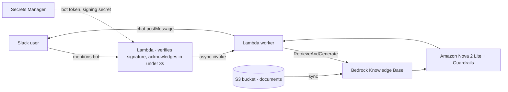

# RAG Assistant on AWS: Bedrock Knowledge Base + Slack

A Retrieval-Augmented Generation (RAG) assistant that answers questions **only from my own documents** stored in S3. Team members mention the bot in Slack and get a threaded answer with source citations.

The sample dataset is a fictional SRE knowledge base (runbooks, policies, and past incidents), built as a proof of concept.

## Architecture



## Features
- Answers grounded in S3 documents, with source citations
- Custom generation prompt: answer only from retrieved results, and say so when nothing is found
- Bedrock Guardrails applied to responses
- Slack integration with signature verification and retry handling
- Fixed footer appended in code so it is guaranteed on every reply
- Secrets kept in AWS Secrets Manager, not in code

## Tech stack
| Area | Service |
|---|---|
| Storage | Amazon S3 |
| Retrieval | Amazon Bedrock Knowledge Base (vector store) |
| Embedding model | _add yours here_ |
| Generation model | Amazon Nova 2 Lite v1 |
| Safety | Amazon Bedrock Guardrails |
| Compute | AWS Lambda (Python 3.12) |
| Secrets | AWS Secrets Manager |
| Chat | Slack app (Events API) |
| Logs | Amazon CloudWatch |

## Repository structure
```
.
├── README.md
├── lambda/
│   └── lambda_function.py      # Slack handler + Bedrock call
├── iam/
│   └── lambda-policy.json      # Least-privilege policy (placeholders)
├── data/                       # Sample documents uploaded to S3
└── docs/images/                # Screenshots
```

## Sample data
14 files in `data/`: 7 runbooks (CrashLoopBackOff, ImagePullBackOff, OOMKilled, Pending pods, ALB 5xx, RDS connections, high CPU), 5 policy and process docs, 1 onboarding FAQ, and a CSV of 12 past incidents.

## Setup

### 1. Upload documents to S3
```bash
aws s3 mb s3://<your-bucket-name> --region us-east-1
aws s3 sync data/ s3://<your-bucket-name>/docs/
```

### 2. Create the Bedrock Knowledge Base
1. In the Bedrock console, create a Knowledge Base with an S3 data source pointing to `s3://<your-bucket-name>/docs/`.
2. Choose an embedding model and a vector store.
3. Click **Sync** on the data source and wait for status **Complete**.
4. Use **Test knowledge base** to try a few questions.

### 3. (Optional) Customize the generation prompt
Keep the `$search_results$` and `$output_format_instructions$` placeholders, and instruct the model to answer only from the search results.

### 4. Create the Slack app
- Bot scopes: `app_mentions:read`, `chat:write`
- Install to the workspace and note the **bot token** and **signing secret**
- Subscribe to the `app_mention` bot event

### 5. Store secrets
```bash
aws secretsmanager create-secret --name slack-rag-bot --region us-east-1 \
  --secret-string '{"bot_token":"<xoxb-token>","signing_secret":"<signing-secret>"}'
```

### 6. Deploy the Lambda
- Runtime: Python 3.12, timeout 60 seconds
- Code: `lambda/lambda_function.py`
- Environment variables:

| Variable | Description |
|---|---|
| `KB_ID` | Knowledge Base ID |
| `MODEL_ARN` | Model or inference profile ARN |
| `SECRET_NAME` | `slack-rag-bot` |
| `GUARDRAIL_ID` | (optional) Guardrail ID |
| `GUARDRAIL_VERSION` | (optional) Guardrail version |

- Attach the policy from `iam/lambda-policy.json` (replace the placeholders)
- Enable a Function URL and paste it into Slack **Event Subscriptions**

### 7. Test
In a Slack channel where the bot is invited:
```
@rag-bot What should I check first when a pod is in CrashLoopBackOff?
```

## Example questions
- What caused INC-1005 and how was it fixed?
- How many minutes of downtime does a 99.9% SLO allow?
- What is the escalation path if the primary on-call does not respond?
- Which past incidents involved a bad release?

A question that is not covered by the documents should return a "could not find an answer" style response, not an invented one.

## Design decisions
- **Grounded answers:** the model answers from retrieved chunks, which reduces hallucination.
- **Async handling:** Slack needs a reply within 3 seconds, so the Lambda acknowledges first and calls Bedrock asynchronously.
- **Security:** Slack requests are verified with the signing secret and timestamp, and retries are ignored. Secrets are in Secrets Manager, and the Lambda role is least-privilege.
- **Deterministic footer:** formatting that must be exact is added in code, because LLM output cannot guarantee it. Guardrails handle safety filtering, not formatting.

## Cost notes
Some vector stores bill while idle. Delete the Knowledge Base and its vector store when you finish testing.

## Possible improvements
- Infrastructure as code with Terraform
- Connect a Kubernetes troubleshooting agent so alerts include runbook steps
- Track token usage and latency per question in CloudWatch
- Restrict the bot to specific Slack channels

## Author
**Sachin Gate**, DevOps / SRE Engineer, Pune, India
