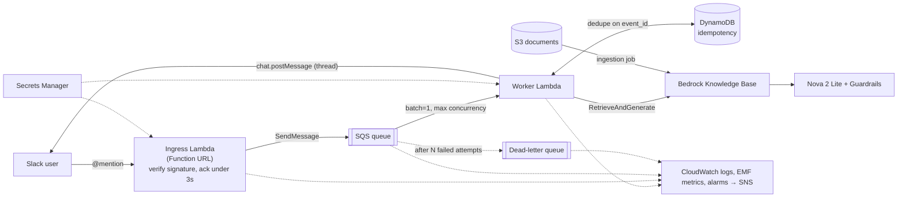

# RAG Assistant on AWS: Bedrock Knowledge Base + Slack

A Retrieval-Augmented Generation (RAG) assistant that answers questions **only from my own documents** stored in S3. Team members mention the bot in Slack and get a threaded answer with source citations.

The sample dataset is a fictional SRE knowledge base (runbooks, policies, and past incidents), built as a proof of concept.

## Architecture



| Component | Responsibility |
|---|---|
| **Ingress Lambda** | Verifies the Slack signature and timestamp, applies team/channel allow-lists, enqueues the mention, returns 200. No Bedrock calls, so it stays well within Slack's 3-second limit. |
| **SQS + DLQ** | Buffers spikes, retries transient failures, and holds messages that failed every attempt for later inspection and redrive. |
| **Worker Lambda** | Queries the Knowledge Base, formats the answer for Slack (mrkdwn, citations, footer), and replies in the thread. Concurrency is capped so it stays under the Bedrock quota. |
| **DynamoDB** | Idempotency store keyed on Slack's `event_id`, so a retry from Slack or SQS never produces a duplicate reply. |

## Features
- Answers grounded in S3 documents, with **source citations** listed under every answer
- Bedrock Guardrails (pin a numbered version in prod); sources are hidden when a guardrail intervenes
- Slack signature and replay protection, optional workspace and channel allow-lists
- Reliable delivery: retries with backoff, idempotent replies, DLQ, and a user-facing error message when all retries fail
- Structured JSON logs with correlation IDs, CloudWatch EMF metrics, X-Ray tracing, and alarms to SNS
- Secrets in Secrets Manager, cached with a 5-minute TTL so rotation works without a redeploy
- Least-privilege IAM per function, all infrastructure in Terraform, CI with lint, tests, `terraform validate` and Checkov

## Tech stack
| Area | Service |
|---|---|
| Storage | Amazon S3 |
| Retrieval | Amazon Bedrock Knowledge Base (vector store) |
| Generation model | Amazon Nova 2 Lite |
| Safety | Amazon Bedrock Guardrails |
| Compute | AWS Lambda (Python 3.12, arm64) + [Powertools for AWS Lambda](https://docs.aws.amazon.com/powertools/python/latest/) |
| Messaging | Amazon SQS (+ DLQ) |
| Idempotency | Amazon DynamoDB (on-demand, TTL) |
| Secrets | AWS Secrets Manager |
| Observability | CloudWatch Logs, Metrics, Alarms, X-Ray, SNS |
| IaC / CI | Terraform, GitHub Actions |

## Repository structure
```
.
├── src/slack_rag/
│   ├── ingress.py        # Function URL handler: verify → filter → enqueue
│   ├── worker.py         # SQS handler: idempotent answer + retry policy
│   ├── rag.py            # Bedrock RetrieveAndGenerate, citations, formatting
│   ├── slack.py          # Signature check, mrkdwn helpers, chat.postMessage
│   └── config.py         # Env config (fail fast) + cached secrets
├── tests/                # pytest unit tests (no AWS needed)
├── infra/terraform/      # Lambdas, SQS, DynamoDB, IAM, Function URL, alarms
├── scripts/build.sh      # Package code + pinned deps for arm64 Lambda
├── data/                 # Sample documents uploaded to S3
├── .github/workflows/    # CI
└── Makefile
```

## Sample data
14 files in `data/`: 7 runbooks (CrashLoopBackOff, ImagePullBackOff, OOMKilled, Pending pods, ALB 5xx, RDS connections, high CPU), 5 policy and process docs, 1 onboarding FAQ, and a CSV of 12 past incidents.

## Setup

Prerequisites: AWS CLI, Terraform >= 1.6, Python 3.12+, and Bash (Git Bash works on Windows).

### 1. Upload documents and create the Knowledge Base
```bash
aws s3 mb s3://rag-datasets --region us-east-1
aws s3 sync data/ s3://rag-datasets/docs/
```
In the Bedrock console, create a Knowledge Base with an S3 data source on `s3://rag-datasets/docs/`, pick an embedding model and vector store, then **Sync**. Optionally customize the generation prompt, keeping the `$search_results$` and `$output_format_instructions$` placeholders and telling the model to answer only from the search results.

To re-sync after editing documents:
```bash
make sync-docs BUCKET=rag-datasets KB_ID=<kb-id> DS_ID=<data-source-id>
```

### 2. Create the Slack app and store its secrets
- Bot scopes: `app_mentions:read`, `chat:write`. Subscribe to the `app_mention` bot event.
- Install it to the workspace, then store the bot token and signing secret:
```bash
aws secretsmanager create-secret --name slack-rag-bot --region us-east-1 \
  --secret-string '{"bot_token":"<xoxb-token>","signing_secret":"<signing-secret>"}'
```
The secret is created outside Terraform so the tokens never land in Terraform state.

### 3. Deploy
```bash
make install          # dev dependencies
make test             # unit tests
cp infra/terraform/terraform.tfvars.example infra/terraform/terraform.tfvars   # fill in values
make plan             # builds build/lambda and runs terraform plan
make deploy
```
Paste the `slack_request_url` output into **Slack → Event Subscriptions → Request URL**. Slack sends a verification challenge, which the ingress function answers.

Key Terraform variables (see `infra/terraform/variables.tf`):

| Variable | Purpose |
|---|---|
| `kb_id`, `model_arn` | Knowledge Base and generation model / inference profile |
| `model_invoke_arns` | ARNs granted `bedrock:InvokeModel` (profile + foundation model in each region it routes to) |
| `guardrail_id`, `guardrail_version` | Optional guardrail. Pin a numbered version in prod |
| `allowed_team_ids`, `allowed_channel_ids` | Restrict which workspaces and channels the bot serves |
| `worker_max_concurrency` | Upper bound on concurrent Bedrock calls |
| `ingress_reserved_concurrency` | Caps ingress. Set `-1` on accounts with the default 10-concurrency quota |
| `answer_footer` | Fixed text appended to every answer (empty disables it) |
| `alarm_email` | Subscribed to the alarm SNS topic |

### 4. Test
```
@rag-bot What should I check first when a pod is in CrashLoopBackOff?
```

## Example questions
- What caused INC-1005 and how was it fixed?
- How many minutes of downtime does a 99.9% SLO allow?
- What is the escalation path if the primary on-call does not respond?
- Which past incidents involved a bad release?

A question that is not covered by the documents should return a "could not find an answer" style response, not an invented one.

## Operations

| Alarm | Meaning | First action |
|---|---|---|
| `dlq-not-empty` | A mention failed every retry (the user saw an error reply) | Check worker logs by `slack_event_id`, fix the cause, then redrive from the SQS console ("Start DLQ redrive") |
| `queue-backlog-age` | Answers are delayed by more than 2 minutes | Look for Bedrock `ThrottlingException` and raise the quota or `worker_max_concurrency` |
| `ingress-errors` / `ingress-throttles` | Slack events are not being acknowledged | Check ingress logs and the reserved concurrency |
| `worker-errors` | Worker crashes or timeouts | Check worker logs and recent deploys |
| `answer-failures` | Users got an error reply | Usually a non-retryable Bedrock error such as a bad config or permissions |

Custom metrics in the `SlackRag` namespace: `MentionsEnqueued`, `AnswersPosted`, `AnswerFailed`, `BedrockLatency`, `GuardrailIntervened`, `UngroundedAnswer` (no citations, a signal of a gap in the docs), `InvalidSignature`, `QuestionTooLong`.

Question text is **not** logged by default. Set `LOG_QUESTIONS=true` on the worker only if your data policy allows it.

## Design decisions
- **Queue instead of a self-invoking Lambda:** SQS adds retries with backoff, a DLQ, back-pressure and a concurrency cap. A fire-and-forget self-invoke has none of these and fails silently.
- **Retries are processed, not dropped:** the old code ignored `X-Slack-Retry-Num`, so a mention was lost whenever the first ack was slow (for example on a cold start). Every delivery is now enqueued, and the worker de-duplicates on `event_id`.
- **Explicit failure policy:** transient errors are retried and the user is told on the final attempt. Permanent errors get a single error reply and are not retried.
- **Grounded answers:** the model answers only from retrieved chunks, and citations are shown so users can verify them.
- **Deterministic footer:** formatting that must be exact is added in code, because LLM output cannot guarantee it.

## Roadmap
- Thread-aware follow-ups: map `thread_ts` to a Bedrock `sessionId`
- 👀 reaction on receipt (needs the `reactions:write` scope)
- Feedback buttons (👍/👎) for offline answer-quality evaluation
- Knowledge Base and vector store in Terraform, and automatic ingestion on S3 upload
- API Gateway + WAF in front of ingress if the Function URL needs rate limiting

## Cost notes
Lambda, SQS and on-demand DynamoDB cost close to nothing at team scale. The main costs are Bedrock tokens and the vector store, and some vector stores bill while idle. Delete the Knowledge Base and its vector store when you finish testing.

## Author
**Sachin Gate**, DevOps / SRE Engineer, Pune, India
